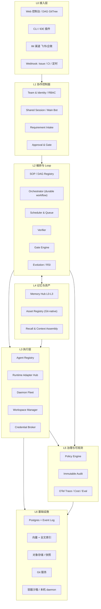
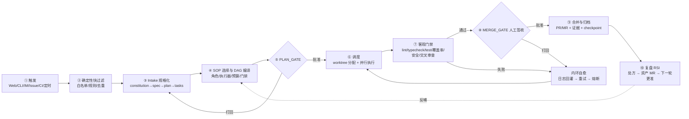
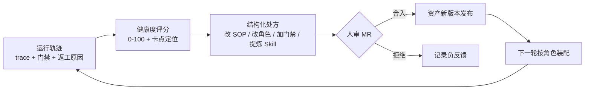
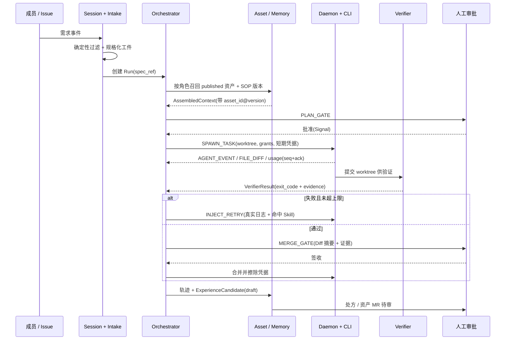

# SuperAgent 研发工具管理平台 · 架构设计讨论稿 v1

> 状态：供评审 / 不含实现代码
> 日期：2026-11-15
> 状态注记（后续实施）：本稿第 1、2、12 章的「现状核实」是 `8eae911` 基线的调研快照，保留原貌；此后已落地 P0 垂直切片、状态机补 3 态、真实 verifier 扩展、IM secret env 注入与 state 脱敏。当前事实以 `.trellis/spec/` 与 `docs/superagent-implementation-plan-v1.md` 为准。
> 基线：`whyzsm/super-agent-platform` `main` @ `8eae91103cf821bb26c80d607bc27ad0a4483d57`（仅有 main 分支）
> 讨论范围：团队化协作、团队记忆云端化与共同成长、N 个 agent 分工协作、需求到研发完成的自动 loop

---

## 0. 结论先行

**定位**：SuperAgent 不是"再做一个 coding agent"，而是**团队级研发工具的统一控制面**。把 Codex / WorkBuddy / Claude Code / OpenCode 等本地 AI 工具与各类 CLI 当作可替换的**执行器**，把团队规范、记忆、角色、SOP 当作**可版本化的组织资产**，用一条带客观门禁与人工签收的**自动 loop** 把需求推进到可合并的交付物。

**对基线仓库的判断**：它是一个**高保真状态机原型，不是可运行平台**。真正有价值的是"契约与语义"（8 态状态机、DAG 依赖解锁、三类门禁、AgentRunnerAdapter、DaemonEnvelope、四级 ACL、Skill 草案提炼）；真正缺的是"真实执行与云端化"。

**建议路线**：保留数据契约与状态机语义，**替换承载层**——单文件 JSON → 云端事件存储 + durable workflow；模拟接口 → 真实 adapter + verifier；本地 `.teamai` 目录 → Git-native 资产仓 + Memory Hub。前端（React + xyflow）与协议类型可以延续，避免推倒重来。

| 核心能力 | 主责模块 | 关键机制 | 主要参考 |
| --- | --- | --- | --- |
| 团队化协作 | Team & Identity / Shared Session / Channel Gateway | 多租户 RBAC、单一 Main Bot 共享会话、IM 审批卡、行级批注、不可变审计 | Octop、LoopForge、OpenBot |
| 团队记忆云端化 + 共享 + 共同成长 | Memory Hub + Asset Registry + Growth Engine | L0–L3 分层、四类资产、Git MR 评审、ACL 混合召回、命中/采纳反馈、RSI 复盘 | TencentDB-Agent-Memory、teamai-cli、LoopForge |
| N 个 agent 分工协作 | Agent Registry / Scheduler / Runtime Adapter Hub / Workspace | 角色-能力-工具 grants 解耦、DAG 调度、ACP/headless/PTY 适配、worktree 隔离、结构化 handoff | openbot、Octop、ACP、Spec Kit |
| 需求→研发完成自动 loop | Orchestrator（durable）+ Verifier + Gate + Evolution | 内环客观门禁自愈 + 外环复盘改写 SOP + 人工最终签收 | LoopForge、Spec Kit、dsh-superagent-prototype |

**三个最重要的架构决策（需拍板）**：

1. **编排层用 durable workflow，而不是继续扩展自写状态机轮询**。人工门禁可能等待数小时到数天、daemon 会掉线、重试必须幂等，这些是分布式执行问题，不是状态机问题。现有 `stateMachine.ts` 下沉为**纯业务规则函数库**，不再承担持久化与调度。
2. **记忆采用"双真相源"，而不是单一向量库**：Git 仓 = 权威资产（skills / rules / agents / hooks / SOP / 模型与 MCP 配置，可评审可回退）；Memory Hub = 运行期记忆与索引（会话、原子事实、场景、画像、代码图、混合检索）。二者以 `asset_id + version + commit_sha` 双向锚定。
3. **执行器绝不进控制面**。控制面只下发 `TaskSpec` / `DaemonCommand`，本地或云端 daemon 拉起 CLI；仓库与模型凭据由网关按身份临时注入、任务结束擦除。任何 CLI 升级、崩溃、网络分区都不能击穿控制面。

**一句话风险提示**：本平台最难的不是"让 N 个 agent 并行写代码"，而是**让团队资产不被自动流程污染、让自动改写流程的权力关在笼子里**。第 9、12 章是这份稿子里最该先讨论的部分。

---

## 1. 基线核实：先说事实，再说设计

### 1.1 仓库事实清单

| 位置 | 事实 |
| --- | --- |
| 技术栈 | React 19 + Vite 8 + Tailwind 4 + zustand + `@xyflow/react`（DAG 画布）+ Express 4 + TypeScript；包管理为 bun（`bun.lock`）；`@google/genai` 在依赖中 |
| `server.ts`（约 45 KB） | 单进程 Express，约 20 个 HTTP 端点；`STATE_FILE = .superagent-state.json`，全量读→改→写回；SSE `/api/stream`；8 秒心跳广播 |
| `src/protocol/index.ts` | 完整类型契约：`AgentProvider`（codex / workbuddy / claude-code / opencode）、`AdapterMode`（headless_json / acp_bidirectional / pty_tmux）、`TaskState` 8 态、`GateType` 3 类、`TaskRole`（planner / builder / reviewer）、`DagNode`、`DaemonEnvelope`、`MemoryAsset`、`TeamAiAsset`、`AgentRunnerAdapter` |
| `src/engine/stateMachine.ts` | `VALID_TRANSITIONS`、`getReadyDagNodes`（依赖全部 MERGED 才解锁）、`transitionTaskVerification`、`resolveGateDecision`、token 预算熔断、4 条危险命令规则、6 类脱敏、`parseSkillFrontmatter`、`extractSkillDraft` |
| `src/daemon/ndjsonParser.ts` | CLI NDJSON → 归一化事件；`OfflineSeqQueue`（seq / ack / replay / 去重） |
| `src/gateway/imWebhook.ts` | HMAC-SHA256 验签 + 300 秒防重放 + 飞书/企微审批卡片 |
| `src/memory/recallEngine.ts` | trigram Jaccard 相似度 + 关键词加权 0.35；只召回 `published`；`team/project/user/agent` 四级 ACL；SKILL 去重评分 |
| `src/components/` | `DagCanvas`、`NodeInspectorPane`、`LeftQueuePane`、`MemoryHubView`、`TeamAiProtocolView`、`DaemonsView`、`NewRequirementModal`；4 个 tab：workbench / memory / teamai / daemons |
| `.teamai/` | `AGENTS.md`（worktree 隔离红线 + lint/typecheck/test 门禁前置）、`skills/` 2 个、`rules/sandbox-guard.md`、`hooks/pre-merge-gate.sh` |
| 单测 | `stateMachine.test.ts`、`ndjsonParser.test.ts`、`imWebhook.test.ts`、`recallEngine.test.ts` —— 纯函数层有测试，是很好的起点 |

### 1.2 关键核实结论：不要把演示态当成实现态

这一点必须先讲清楚，否则后面所有设计都会建立在错误前提上。

| 表面能力 | 实际实现 | 对设计的影响 |
| --- | --- | --- |
| "多 CLI 协同编排" | `server.ts` 全文**无 `child_process` / spawn / CLI 进程**，无真实 CLI 会话；`/api/tasks/:id/advance` 由人手工推进，`verifierChecks` 硬编码 `passed: true`，另有 `/simulate-failure`、`/simulate-danger` 注入假事件；`unlockReadyNodesForRequirement` 只改内存对象并广播一条描述性事件 | 现有"调度器"是流程模拟器。真正的 Scheduler / Adapter / Verifier 全部要新建 |
| "调用 Gemini" | `metadata.json` 声明 `MAJOR_CAPABILITY_SERVER_SIDE_GEMINI_API`、`.env.example` 有 `GEMINI_API_KEY`，但 `server.ts` **未 import `@google/genai`**，也没有任何 LLM 调用 | 规划、复盘、审查模型代批都需要新建 Model Gateway |
| "Git Worktree 物理隔离" | 只有 `worktreePath` / `worktreeBranch` 字符串字段与日志文本，无 `git worktree add` | 需要 Workspace Manager 真正建/销毁/快照 worktree |
| "云端团队记忆中枢" | 召回是内存 trigram 相似度，无数据库、无向量索引、无网络服务；状态全在提交进仓库的 `.superagent-state.json`（32 KB） | 需要 Memory Hub + 存储层 + 多租户隔离 |
| "MCP 记忆召回" | `/api/mcp/recall` 是一个普通 HTTP POST，不是 MCP server | 需要按 MCP 规范暴露工具，才能被各 CLI 直接调用 |
| "Skill 同步到 Git" | `solidify-sop` / `memories/:id/approve` 会写本地 `.teamai/skills/*.md` 并把 `syncedToGit` 置为 `true`，但**没有任何 git add/commit/push/MR** | `syncedToGit` 是假状态；Git-native 评审闭环是新增工作量 |
| 硬编码 | `teamId='team-platform-core'`、`createdBy='lin.wei'`、`IM_WEBHOOK_SECRET` 默认明文 `superagent-dev-im-secret`、内部 hostname 与机器名写在 seed 与 state 中 | 身份、密钥、环境元数据必须外置；**已提交的 state 文件需移出版本控制并脱敏** |

> **注（后续修订）**：上表描述的是本讨论稿落笔时的真实起点，保留作为差距基线。其中两项已在第二轮落地，阅读时不要按上表判断当前现状：①「Git Worktree 物理隔离」→ 已由 `src/workspace/worktreeManager.ts` 真实 `git worktree add/remove` 兑现；②「MCP 记忆召回」→ `/api/mcp` 已是标准 JSON-RPC 2.0 端点（`src/mcp/server.ts`）。以 `docs/superagent-unblock-solution-v1.md` §9.5 为准。

**但这些东西值得保留**：`parseSkillFrontmatter` 与开放 Agent Skills 规范的 frontmatter 思路一致；`MemoryAsset.acl` 四级与 TencentDB 团队资产的权限模型同构；`DaemonEnvelope.seq` + `OfflineSeqQueue` 是靠谱的断线续传雏形；`detectDangerousCommand` / `redactSecrets` 可以直接演化为策略规则集；8 态状态机与三类门禁的业务语义基本正确。

### 1.3 能力差距矩阵

| 维度 | 原型现状 | 目标态 | 差距 |
| --- | --- | --- | --- |
| 身份与租户 | 单团队、硬编码用户名 | 多团队/项目/角色 RBAC + SSO | 大 |
| 共享会话 | 无 | 团队共享会话 + 单一 Main Bot + 结构化 handoff | 大 |
| 执行器接入 | 类型契约有、实现无 | ACP / headless-json / PTY 三通道真实拉起 | 大 |
| 客观验证 | 硬编码全绿 | lint / typecheck / test / coverage / 安全扫描按退出码判定 | 大 |
| 状态持久化 | 单文件 JSON 全量覆盖写 | append-only event log + workflow history + 关系库投影 | 大 |
| 崩溃恢复 | 弱（离线队列仅前端模拟） | 幂等重试、checkpoint、worktree 快照、租约与 Watchdog | 大 |
| 记忆 | 本地 trigram + 状态文件 | 云端分层记忆、混合召回、ACL、版本、审核发布 | 大 |
| 资产协作 | 本地写文件 | Git MR 评审、版本、回退、跨 16+ 工具分发 | 中大 |
| agent 间协作 | DAG 依赖 + 文字事件 | 角色注册表、能力/工具授权、结构化交接、订阅追问 | 中 |
| 自动触发 | 全人工点按钮 | Web/CLI/IM/Issue/CI/定时事件驱动 + 确定性快过滤 | 大 |
| 可观测 | 内存事件数组 + SSE | OTel GenAI trace / cost / eval / 不可变审计 | 大 |
| 成长闭环 | 失败任务提炼 SKILL 草案（已有！） | 草案→去重→评审→发布→召回命中→淘汰 + SOP 复盘改写 | 中（起点很好） |

---

## 2. 目标、非目标与约束

**目标**

- G1 统一管理：一个控制面注册、发现、配置、升级、审计所有本地 AI 工具与 CLI，成员不换工具、不锁生态。
- G2 团队化：产品/设计/研发/测试在同一需求现场协作，上下文不靠复制粘贴，权限与审批可追溯。
- G3 团队记忆云端化：记忆是组织资产而非个人缓存，跨工具、跨成员、跨模型迁移不失效；有评审、有版本、有淘汰，越用越准。
- G4 N agent 分工：角色可注册、能力可授权、任务可并行、交接有契约、冲突可检测。
- G5 自动 loop：需求进 → 规格 → 计划 → DAG → 隔离执行 → 客观门禁 → 人工签收 → 合并交付 → 复盘进化，全程可暂停/恢复/接管。

**非目标**

- 不自研模型、不重写 coding agent 的代码生成能力；不做通用办公 agent；不做 IDE。
- v1 不做跨组织联邦、不做模型训练/微调、不做 SOP 市场公开分发。
- 不把"全自动无人值守"当作默认模式：默认 `observe`（只出方案与 Diff），稳定后再按范围放开 `auto`。

**硬约束**

| 约束 | 含义 |
| --- | --- |
| 凭证边界 | 本地 CLI 登录态、Git token、模型 key 不出本机/内网；模型不接触明文密钥 |
| 数据合规 | 日志/轨迹/Diff/记忆写入前脱敏（API key、邮箱、DB 连接串、PII） |
| 人的最终权 | 合并、发布资产、改写 SOP、放开权限，四件事必须人审 |
| 多租户隔离 | team / project / user / agent 四级 ACL，读、写、管理分离 |
| 环境碎片 | 同一团队会有不同 OS、CLI 版本、模型账号；适配器必须容忍能力差异 |
| 网络分区 | 开发机合盖、VPN 抖动、CI 机重启是常态，不是异常 |

**建议验收指标**（数值待团队确认）：一次通过率、平均返工次数、门禁误放行率（必须为 0）、记忆召回命中率与采纳率、人均并行活跃需求数、需求平均交付时长、token/需求成本、daemon 掉线后任务恢复率。

---

## 3. 参考项目调研与借鉴边界

### 3.1 先辨析同名项目（这直接影响"能不能用"）

| 名字 | 实际项目 | 与本平台的关系 |
| --- | --- | --- |
| **openbot（技能）** | ① `nightly-labs/openbot`：本地优先桌面多 agent 工作区，ACP 接入十余种 CLI，FIFO 队列、共享频道、agent 间消息、agent 可从工作流创建 skill 存入共享本地库供同伴安装。许可证 **PolyForm Noncommercial 1.0.0，非 OSI 开源，商用需授权**；② `CopilotKit/OpenBot`：治理型 AI coworkers，**skills 是"指令而非能力"**，每次运行可用的工具集 = skill 声明的工具列表 ∩ Bot 被授予的 grants；CEL/JSON 策略引擎先写审计行再放行；MIT 模板但 Intelligence 组件单独许可；③ `meetopenbot/openbot`：local-first harness，`AGENTS.md` + plugins + SSE 事件 API | 用户标注的"技能"我按 ①+② 的交集理解：**技能是可分发、可授予、可审计的指令资产**。借鉴其机制与格式，**不引入桌面壳、不混入非商业许可代码** |
| **lancer** | `raylee-ai/lancer`（Alpha，基于 pi/pi-gui）：模块会话可配置阶段/模型/Skill/目标/交付要求；任务可派生子分支、孙分支并汇总回父会话；**GitTree 是任务事件图，节点不全是 Git 提交**；会话可勾选独立 worktree（`lancer/` 分支），多会话并行改文件互不覆盖；运行过程用同色光线把模型/交付动作连到节点 | 借"会话树 + 事件图 + 交付节点"的可视化语义，把现有 `DagCanvas` 从静态 DAG 升级为可分支、可回溯、可下钻的运行图 |
| **Octop** | `TencentCloud/Octop`（MIT，Python，自托管多用户多 agent）：单进程 + 一个控制面 DB（SQLite/PostgreSQL），四个 harness 库 `octop-harness`（运行时）/`octop-gateway`（IM 归一）/`octop-memory`（分层记忆）/`octop-browser`；JWT 隔离、专家库与专家市场、共享资源池、AgentTeams（协调者排多专家）、Connectors(OAuth+MCP)、ACP 双向、cron、可插拔 workspace 后端 | 借"多用户专家目录 + 渠道网关 + 凭据隔离 + 单进程可重启恢复"的工程分层；**不借**其家庭/个人助手的产品定位与"什么都装进一个进程"的部署取舍（团队研发场景需要存算分离） |
| **TencentDB-Agent-Memory** | `TencentCloud/TencentDB-Agent-Memory`（MIT）：短期 = Context Offloading + Mermaid 任务画布（工具日志外置，`node_id` 下钻回原文，无损溯源）；长期 = **L0 原始对话 → L1 原子事实 → L2 场景块 → L3 画像** 的语义金字塔；异构存储（底层 DB 全文可检、上层 Markdown 白盒可读）；Team Memory 四类资产 **Chat Memory / LLM-Wiki / Code Graph / Skill**，Memory Hub 统一生成、审核、授权、装配，按角色动态组装；框架中立、插件化 | **记忆层的主参考**。直接对齐四类资产、L0–L3、渐进披露、按角色装配、可下钻溯源。注意其 README 明确"自动 Skill 生成 / 跨框架可移植记忆 / 可视化调试"仍在 roadmap，这部分得我们自己补 |
| **teamai-cli** | `Tencent/teamai-cli`（MIT）：把团队的 skills / rules / culture / agents / hooks / MCP / workflows / env / models 放进 Git 仓；`push` 自动建分支发 MR → 评审 → 合入 → 会话启动 hook 自动 `pull`；三层能力 **Team Execution / Team Context(beta) / Team Improvement(beta)**；摩擦信号（反复纠正、工具调用失败）驱动经验捕获；20 种 agent 适配矩阵；usage/sessions/scorers/benchmarks 看板 | **资产分发与"共同成长"的主参考**。可直接复用其 CLI 与 manifest 思路，或至少对齐目录规范。它证明"配置即代码 + MR 评审"是团队级 AI 协作的正确抽象 |
| **LoopForge** | `Tencent/LoopForge`（MIT，Go，自托管）：把 Coding Agent、确定性脚本、人工决策编成 **DAG-SOP**；节点分 Agent / Script / Human-gate / 子 SOP；五层解耦（岗位角色 / SOP 流程 / 执行引擎 / 运行环境 / **交付物契约**）；客观门禁按退出码判定、失败附日志打回、重试上限；7×24 云端沙箱 + 快照休眠；共享会话 + Main Bot 主副驾；三挡权限与独立审查模型代批；**工程级 RSI**（运行后打分诊断、生成处方、改写 SOP/角色/门禁）；定时与 Issue 全链路自动化 | **自动 loop 的主参考**。特别是"流程固定、AI 灵活""节点间只传结构化交付物""内环自愈 + 外环进化"。同名 `kennethlaw325/loopforge` 是只做 loop 设计、不启动 loop 的 skill，别混淆 |

**补充查找的项目**（补足缺口）：

| 项目 / 规范 | 补什么缺口 | 借鉴点 |
| --- | --- | --- |
| `github/spec-kit` | 需求 → 规格的结构化产物链 | `constitution → specify → plan → tasks → implement → converge`，每阶段产出可评审 Markdown 工件，规格是活文档而非一次性提示词；38 种 agent 集成，无锁定 |
| `deepseek-ai/dsh-superagent-prototype` | 常驻调度与"注意力经济" | Router（只派活、不写代码、不给人 bash）/ Worker（独立会话与目录并行）/ 事件驱动快过滤 / 追问直达 Worker 的订阅机制 / 外部 Watchdog / 存算分离 / 默认 observe 授权。其论文明确把长期记忆、agent 间通信、凭据注入的提示注入风险列为开放问题 |
| **ACP**（Agent Client Protocol） | 统一 CLI 接入 | JSON-RPC 2.0 over stdio，复用 MCP 类型并扩展 diff 等编码 UX；ACP Registry 已有 28+ agent（Claude Code、Codex CLI、Copilot CLI、Gemini CLI、OpenCode…）。把 M×N 适配降成 M+N |
| **MCP** | 工具 / 记忆暴露 | 平台把 `memory_recall`、`memory_propose`、`task_status` 等暴露为 MCP 工具，各 CLI 无需插件即可用 |
| **Agent Skills 规范**（agentskills.io） | 技能格式统一 | `SKILL.md` + YAML frontmatter（`name` / `description` 必填）+ `scripts/` `references/` `assets/`；三级渐进披露。原型 `parseSkillFrontmatter` 应改成对齐该规范，自定义 `triggers/scope/version` 移到 `metadata` |
| **Temporal / LangGraph** | durable loop | workflow 每步 checkpoint、Activity 幂等重试、Signal 实现人工门禁的"等待数小时不烧算力"、不可变 history 直接当审计；LangGraph 的 `interrupt()` + Temporal 插件是现成组合 |
| **OpenTelemetry GenAI + Langfuse** | 轨迹与评测 | `invoke_agent / chat / execute_tool / retrieval` span 树，`gen_ai.*` 属性、成本与 token、轨迹评估、跨服务 trace ID 传播；内容是默认关闭捕获的（PII 风险），eval 在 trace 之上 |
| **OPA / Casbin、CEL** | 策略引擎 | 危险命令、路径白名单、工具 grants 交集、三挡放行用声明式策略表达，而不是散落的正则 |
| **Graphiti / mem0 / Letta** | 记忆后端备选 | 时序知识图谱、可移植记忆；v1 不引入，作为 Code Graph 与长期记忆演进的备选 |

### 3.2 一个必须讨论的问题：为什么不直接用 LoopForge + teamai-cli + TencentDB-Agent-Memory 拼起来？

三者都很强，但**重心不同**：

- LoopForge 管的是**交付流程**（需求 → SOP → MR），执行器是它的下游；
- teamai-cli 管的是**资产分发**（团队配置同步到各 agent），不关心任务状态；
- TencentDB-Agent-Memory 管的是**记忆存取**，不关心谁在跑、跑到哪一步。

本平台的独特目标是**"研发工具的统一管理"**：把各 CLI 作为一等公民注册、计量、授权、升级，让同一个团队资产同时被 Codex / WorkBuddy / Claude Code 消费，并让任务轨迹反哺工具配置本身。这个"工具注册 + 跨工具资产一致性 + 执行器治理"的横切面，三者都不覆盖。

**建议**：协议与格式层**直接采用**（ACP / MCP / Agent Skills），实现层**优先复用 MIT 组件**（teamai-cli 的分发机制、TencentDB-Agent-Memory 的记忆引擎），流程语义**借鉴** LoopForge 但自研控制面，避免把平台变成别人流程的二次封装。三个项目都是 MIT，Nightly Labs 的 openbot 与 CopilotKit Intelligence 有许可限制，只能借鉴不能混入。

---

## 4. 总体架构

### 4.1 分层视图

### 4.2 两条总线与一条真相链

| 通道 | 承载 | 从原型继承 |
| --- | --- | --- |
| **控制总线** | `TaskSpec`、`DaemonCommand`（SPAWN_TASK / INJECT_RETRY / GATE_DECISION / ABORT_TASK）、`DaemonEnvelope v2`（HEARTBEAT / AGENT_EVENT / TERMINAL_CHUNK / VERIFY_RESULT / STATE_ACK / HANDOFF）| 沿用 `src/protocol/index.ts` 的 envelope 与 `OfflineSeqQueue` 的 seq/ack/replay，补 `trace_id`、`idempotency_key`、`lease` |
| **记忆总线** | `RecallRequest`（team/project/user/agent + 角色 + 任务语义）、`AssembledContext`（带来源与命中分）、`ExperienceCandidate`（带 source_task_id、证据链、去重分）| 沿用 `MemoryAsset` / `AssetAclEntry` / `recallMemoryAssets` 的 ACL 语义，替换召回实现 |
| **真相链** | 需求 → 规格工件 → SOP 版本 → DAG 运行 → 门禁证据 → 合并 commit → 轨迹 → 记忆资产版本 | 原型缺"证据链"这一环；所有自动结论必须能下钻到原始日志/命令/退出码 |

**单一真相源约定**：

| 对象 | 权威来源 | 派生物 |
| --- | --- | --- |
| 团队资产（skill/rule/agent/hook/SOP/配置） | Git 仓（commit_sha + 版本 tag） | Memory Hub 索引、各 agent 本地目录 |
| 运行态 | Workflow history + append-only event log | 前端投影、看板、指标 |
| 运行期记忆（会话/事实/场景/画像/代码图） | Memory Hub | 上下文装配、图谱、向量索引 |
| 代码 | 目标仓库 + worktree 快照 | Diff、PR、评审意见 |

---

## 5. 模块职责

> 每个模块只列职责、输入、输出、状态归属、依赖与"和现有代码的关系"；不写实现。

### 5.1 协作控制面（L1）

| 模块 | 职责 | 输入 → 输出 | 状态归属 | 依赖 / 现有代码对应 |
| --- | --- | --- | --- | --- |
| **M1 Team & Identity** | 团队/项目/成员/角色/服务账号；SSO/OIDC；RBAC；配额 | 登录与邀请 → 身份令牌、ACL 上下文 | Postgres | 新增。替换硬编码 `team-platform-core` / `lin.wei` |
| **M2 Shared Session & Channel Gateway** | 一个需求 = 一个团队共享会话 + 一个 Main Bot；Web/CLI/IM 消息归一化；追问路由到已认领的 Worker；审批卡片回传 | 多渠道事件 → 归一化会话事件 → 审批决策 | 会话存储（云端） | 扩展 `imWebhook.ts`（保留 HMAC + 300s 防重放）；参考 Octop gateway / DeepSeek Router |
| **M3 Requirement Intake & Spec Compiler** | 接收自然语言需求/Issue，按 Spec Kit 风格产出 `constitution / spec / plan / tasks` 活文档；识别仓库、基线分支、风险等级 | 需求文本 → 结构化 `Requirement` + 规格工件 | Git（工件版本化） | 扩展 `Requirement` 类型；新增 Model Gateway 调用 |
| **M4 Approval & Human Gate** | PLAN / DANGER / MERGE 三类门禁；Web/IM 审批；行级批注；暂停/恢复/接管/终止；三挡放行 | `GateRequest` → `GateDecision`（含 reviewer、时间、证据） | Workflow history（不可变） | 保留 `TaskCheckpoint` / `resolveGateDecision` 语义；新增独立审查模型代批 |

### 5.2 编排与自动 loop（L2）

| 模块 | 职责 | 输入 → 输出 | 状态归属 | 依赖 / 现有代码对应 |
| --- | --- | --- | --- | --- |
| **M5 SOP / DAG Registry** | 版本化 SOP 模板（feature / bugfix / 巡检 / Issue 修复）；节点定义角色、执行器、门禁、预算、交付物契约；支持子 SOP | 模板 + 需求特征 → 编译后的 DAG 实例 | Git | 替换 `server.ts` 里硬编码的 `feature_flow` / `bugfix_flow` 分支；`solidify-sop` 演进为"提 MR 而非直接写盘" |
| **M6 Orchestrator（durable）** | 驱动整条主链路；状态持久化、幂等重试、checkpoint、Signal 等待人工、超时/补偿、`continue-as-new`；发出状态迁移 | DAG 实例 → 节点状态迁移 / 门禁请求 | Workflow engine（唯一权威） | **`stateMachine.ts` 下沉为纯函数**：`canTransition` / `transitionTaskVerification` / `resolveGateDecision` 保留，去掉内存态修改 |
| **M7 Scheduler & Queue** | 依赖解析、并行度控制、机器亲和性、优先级、租约、公平队列、并发文件写集冲突检测 | 就绪节点 → 分配给 daemon 的 `SPAWN_TASK` | 队列 + 租约表 | 替换 `getReadyDagNodes` / `unlockReadyNodesForRequirement`；保留"依赖全部 MERGED 才解锁"语义 |
| **M8 Verifier** | 确定性门禁：lint / typecheck / unit test / 增量覆盖率 / 安全扫描 / 构建 / 契约校验；按退出码判定，收集日志与 Diff；异构模型交叉审查作为独立节点 | Worktree → `VerifierResult(passed, logs, diff, evidence_ref)` | 对象存储（证据） | 新建。替换硬编码 `passed: true`；对接 `.teamai/hooks/pre-merge-gate.sh` |
| **M9 Gate Engine** | 把 Verifier 结果、危险命令拦截、预算熔断、人工决策统一成状态迁移；`maxRetries` 后 ESCALATED | 多源结论 → 下一状态 / 重试注入 | Workflow | 复用 `transitionTaskVerification` / `recordUsageAndCheckBudget` / `detectDangerousCommand` |
| **M10 Evolution / RSI Engine** | 运行后回放轨迹，打分诊断，产出结构化"处方"（改 SOP 节点 / 角色规范 / 门禁 / 新增 Skill），生成 MR 供人审 | Run trace → `Prescription` → Git MR | Git + 指标库 | 原型 `extractSkillDraft` 是内环的最小形态，扩展为跨运行外环 |

### 5.3 执行层（L3）

| 模块 | 职责 | 输入 → 输出 | 状态归属 | 依赖 / 现有代码对应 |
| --- | --- | --- | --- | --- |
| **M11 Agent Registry** | 注册 N 个 agent 角色：职责说明、允许的技能/规则、工具 grants、默认执行器与模型、预算、可见范围；版本化 | 角色定义 → `AgentDefinition` | Git + DB | 新增。替换 `TaskRole` 三值枚举与散落在 `server.ts` 节点里的角色描述 |
| **M12 Runtime Adapter Hub** | 三通道适配：`headless-json`（`--output-format stream-json`）、`acp_bidirectional`（ACP JSON-RPC，支持工具审批拦截）、`pty_tmux`（无 API 的 CLI）；统一输出 `NormalizedAgentEvent` | `TaskSpec` → 事件流 / `sendInput` / `approveTool` / `terminate` | 会话句柄 | **直接落地 `AgentRunnerAdapter` 接口**（原型已定义但未实现）；优先做 ACP，因为它把 M×N 变 M+N |
| **M13 Daemon Fleet** | 注册机器/容器，上报心跳、能力、负载、CLI 版本；拉取任务；离线事件队列与重放；崩溃恢复 | `DaemonCommand` ↔ `DaemonEnvelope` | 租约 + seq/ack | 沿用 `DaemonRunner` / `OfflineSeqQueue`；补 lease、版本协商、签名 |
| **M14 Workspace Manager** | 真正创建/销毁 `git worktree`（`~/.superagent/worktrees/<repo>/<taskId>` 或云沙箱）；多仓检出、端口分配、快照休眠/唤醒、写集冲突检测 | 分配请求 → 工作区句柄 + 快照 | 对象存储 + 本地盘 | 把字符串字段变成真实资源；参考 Lancer 会话 worktree 与 LoopForge 云端快照 |
| **M15 Credential Broker** | 按身份临时注入 Git token / 模型 key；任务结束擦除；模型侧只见占位符；出网白名单 | 任务身份 → 短期凭据 | KMS / 密钥库 | 新增。**这是最容易被提示注入击穿的地方**，见第 9 章 |

### 5.4 记忆与资产（L4）

| 模块 | 职责 | 输入 → 输出 | 状态归属 | 依赖 / 现有代码对应 |
| --- | --- | --- | --- | --- |
| **M16 Memory Hub** | L0 原始轨迹 → L1 原子事实 → L2 场景块 → L3 画像；短期 Context Offloading（Mermaid 画布 + `node_id` 下钻）；四类资产 Chat Memory / LLM-Wiki / Code Graph / Skill；白盒可读、可回退、可导出 | 轨迹与文档 → 分层记忆资产 | Postgres + 向量/全文索引 + Markdown | 对齐 TencentDB-Agent-Memory；替换 `recallEngine.ts` 的 trigram |
| **M17 Asset Registry（Git-native）** | 团队资产仓：`.teamai/` 下 agents.md / rules / skills / hooks / sop / mcp / env / models；`push → MR → 评审 → 合入 → hook pull` 分发到各 CLI；版本、回退、跨工具适配矩阵 | 资产变更 → MR → 分发 | **Git 为唯一权威** | 原型 `.teamai/` + `TeamAiAsset.syncedToGit` 升级；对齐 teamai-cli 与 Agent Skills 规范 |
| **M18 Recall & Context Assembly** | 按 team/project/user/agent 四级 ACL 过滤；向量 + BM25 + 图关系混合召回；只返回 `published`；按角色动态装配（修 bug 优先 Code Graph + 历史排障 Skill，需求分析优先 Wiki + 历史讨论）；记录命中与采纳 | `RecallRequest` → `AssembledContext`（带来源、版本、命中分） | 指标库 | 保留 `findMatchedAcl` / 反污染规则；新增 MCP server 暴露 `memory_recall` / `memory_propose` |

### 5.5 治理、可观测与控制台（L5 / L0）

| 模块 | 职责 | 关键说明 |
| --- | --- | --- |
| **M19 Policy & Audit** | 声明式策略（CEL/OPA）：危险命令、路径白名单、工具 grants 交集、三挡放行、预算/配额；所有动作"先写审计行再执行"；不可变审计链 | 对齐 CopilotKit OpenBot 的治理顺序；`redactSecrets` 升级为分类器 + 出网过滤 |
| **M20 Observability & Eval** | OTel GenAI span 树（`invoke_agent / chat / execute_tool / retrieval`），跨服务 trace ID 传播；token/成本/延迟/重试次数；轨迹评估、数据集与回归实验 | 轨迹既是排障依据，也是 RSI 与记忆写入的输入；内容捕获默认关闭 |
| **M21 Console** | 需求队列、DAG GitTree（分支/合并/交付节点）、节点检查器（事件流 / Diff / 行级批注 / 终端）、Memory Hub 审核台、资产仓 MR 视图、Daemon 舰队、成本与质量看板 | 沿用 React + xyflow；把 Lancer 的"会话树 + 光线反馈"语义加进来；4 个 tab 扩展为工作台/记忆/资产/舰队/治理 |

---

## 6. 核心契约（语义约定，非代码）

| 契约 | 关键字段语义 | 为什么重要 |
| --- | --- | --- |
| `Requirement` | `id, team_id, project_id, title, spec_ref, repo_ref, base_branch, source_channel, risk_level, created_by` | 需求是活文档引用，不是一段聊天文本 |
| `TaskSpec` | `task_id, req_id, role_ref, provider, adapter_mode, sop_version, input_artifacts, allowed_tools, skill_refs, budget, workspace_ref, idempotency_key` | **节点间只传结构化交付物**，不传聊天记录（LoopForge 第五层） |
| `HandoffContract` | `producer, consumer, artifact_type, artifact_ref, checksum, checks_passed, open_questions` | 上游边界条件不再淹没在长对话里 |
| `VerifierResult` | `checks[], exit_code, logs_ref, diff_ref, coverage_delta, evidence_ref` | 门禁结论必须能下钻到原始退出码 |
| `GateDecision` | `gate_type, decision, reviewer_id, comment, evidence_ref, decided_at` | 人工签收进不可变 history；IM 回调须验签 + 防重放 |
| `ExperienceCandidate` | `asset_type, source_task_id, source_run_id, evidence_chain[], duplicate_score, proposed_by, status` | **自动产出只能是 draft**，评审后才 published |
| `DaemonEnvelope v2` | `machine_id, seq, ts, trace_id, lease_id, payload` | seq/ack 保证断线重放不丢事件；trace_id 串起跨服务轨迹 |
| `AgentDefinition` | `role_ref, skills[], rules[], tool_grants[], executor, model_ref, budget, scope, version` | 实际可用工具 = skill 声明工具 ∩ agent grants ∩ 策略允许（借鉴 OpenBot） |
| `SopDefinition` | `version, dag, gates[], retry_policy, budgets, artifact_contracts, change_log` | SOP 可被处方改写，但每次改写生成新版本且需人审 |

---

## 7. 关键流程

### 7.1 F1：需求 → 研发完成的主链路（自动 loop 全景）

| 阶段 | 主责 | 输出 | 主要失败点 | 恢复策略 |
| --- | --- | --- | --- | --- |
| ① 触发 | M2 | 归一化事件 | 事件噪声、提示注入、重复触发 | 确定性快过滤先于模型；幂等键；默认 observe |
| ② 过滤 | M2 / M19 | 是否受理 | 误放行 | 白名单 + 规则 + 审计行 |
| ③ 规格化 | M3 | 活文档工件 | 需求含糊、仓库不明 | `clarify` 阶段 + PLAN_GATE 打回 |
| ④ 编译 | M5 / M11 | DAG 实例 | 角色无可用执行器、预算不足 | 调度前能力校验，失败直接 ESCALATED |
| ⑤ 计划门禁 | M4 | GateDecision | 人迟迟不批 | durable Signal 等待，不占算力；SLA 提醒 |
| ⑥ 执行 | M7 / M12 / M13 / M14 | 事件流 + Diff | CLI 崩溃、机器掉线、worktree 冲突 | 租约 + seq/ack + checkpoint + 快照恢复 + Watchdog |
| ⑦ 验证 | M8 | VerifierResult | 测试"静默腐化"（脚本没测到新逻辑） | 增量覆盖率 + 门禁脚本自身版本化 + 定期 eval |
| ⑧ 签收 | M4 / M9 | 合入许可 | 审批越权、IM 回调伪造 | HMAC + 300s 防重放 + 独立审查模型代批 + 他人发言不能授权 |
| ⑨ 交付 | M6 / M14 | PR + 证据包 | 合并冲突 | 冲突回灌给 builder 节点重跑 |
| ⑩ 进化 | M10 / M17 | 处方 MR | **自动改写失控** | 处方只能提 MR，人审 + 灰度 + 可回退 + 禁止删门禁 |

**关键设计取舍**：小改动走"Main Bot 直接改 + 提 MR"的短路径，只有正式需求才派发 SOP；两条路径共用同一套记忆、策略与审计。否则所有需求都走重流水线，团队会绕开平台。

### 7.2 F2：内环自愈（单次运行）

沿用原型的 8 态，但由 workflow 持久化：

`PENDING → RUNNING → VERIFYING → HUMAN_GATE → MERGED`

失败分支：`VERIFYING → RETRY_WAIT → RUNNING`（把**真实报错堆栈 + Diff + 命中的团队 Skill** 注入重试）；`retryCount ≥ maxRetries` 或 `token ≥ budget` 或 `DANGER_GATE` → `ESCALATED`（挂起，交人）；`HUMAN_GATE` 被拒 → `RETRY_WAIT`；任意态可 `CANCELLED`。

建议补三个状态：`BLOCKED_BY_RESOURCE`（等机器/等凭据）、`QUARANTINED`（疑似污染/注入攻击）、`WAITING_APPROVAL`（长时人工等待，与 HUMAN_GATE 区分以便统计）。**Watchdog** 定期检查节点是否真有进展（事件 seq 是否推进、文件是否变化），卡死则触发诊断而非无限重试。

### 7.3 F3：外环成长（跨运行 RSI）

处方必须受护栏约束：**不能删除已有门禁、不能放宽预算上限、不能给自己签名、不能跨团队发布资产**；每个处方带证据链与影响面，支持一键回滚到上一版本。这是 LoopForge "SOP 可被 Agent 改写"最值得抄、也最需要关笼子的地方。

### 7.4 F4：团队记忆的共享与共同成长

**三条路径**

| 路径 | 步骤 | 防污染措施 |
| --- | --- | --- |
| 写入 | 会话/PR/评审/排障轨迹 → 脱敏 → 分层提炼（L0→L3）→ `ExperienceCandidate` → 与既有 SKILL 算重复度 → 人工审核 → `published` → 建索引 → 同步 Git | 只收录 `published`；draft 与 published 物理/逻辑隔离；来源必须可下钻；PII 与密钥分类器前置 |
| 读取 | 调用方身份 + 任务语义 + 角色 → 四级 ACL → 向量 + BM25 + Code Graph 混合召回 → 按角色装配 → 注入上下文 → **记录命中** | 每次注入带 `asset_id@version`，事后可解释"为什么当时给了这段记忆"；超出 token 预算按分层降级（先 L3/L2，下钻 L1/L0） |
| 反馈 | 采纳/忽略/纠正/报错信号 → 更新资产命中率与采纳率 → 低分资产进入复评 → 归档淘汰 | 负反馈同样要进指标；避免"越写越多、越召越脏" |

**四类资产与职责**

| 资产 | 来源 | 主要消费者 | 存储 |
| --- | --- | --- | --- |
| Chat Memory | 历史会话与共享会话 | 需求分析、澄清、接管 | Postgres + 全文/向量 |
| LLM-Wiki | 项目文档、规范、架构决策 | planner、reviewer | Markdown（Git）+ 索引 |
| Code Graph | 仓库 AST / 符号 / 调用链 | builder、reviewer、影响面分析 | 图/关系索引 |
| Skill / SOP | 成功排障、返工教训、已完成流水线 | 所有角色，按触发条件装配 | **Git 权威** + Hub 索引 |

"共同成长"的定义要可度量：**不是记忆条数变多，而是首次通过率上升、返工次数下降、召回命中/采纳率上升、低质资产被淘汰**。建议把这四项做成 Memory Hub 首页看板（对齐 teamai-cli 的 usage/sessions/scorers/benchmarks）。

### 7.5 F5：N 个 agent 分工协作

1. **注册**：`AgentDefinition` 定义角色、技能、规则、工具 grants、执行器、预算、可见范围；角色与具体 CLI 解耦（换 Codex 为 WorkBuddy 不改 SOP）。
2. **装配**：调度时把 `skills[] ∩ tool_grants[] ∩ policy` 作为本次运行的实际工具集；只加载本角色专属规范，**屏蔽个人本地杂乱配置**。
3. **调度**：DAG 依赖 + 并行度 + 机器亲和性 + 文件写集冲突检测；每个节点独立 worktree 与端口。
4. **交接**：`HandoffContract` 传递结构化交付物，禁止"把聊天记录粘给下游"。
5. **通信**：agent 间消息走会话订阅；**对同一工单的追问直达原 Worker**，不回 Main Bot 重新派发（DeepSeek 原型测得不这样做会让 Router 决策量涨约 30%）；跨节点只通过交付物契约与事件，不允许自由群聊式互改。
6. **交叉审查**：reviewer 必须异构 provider（不同模型家族），避免"同家族模型犯同样的错"；审查 agent 无写权限、无凭证。
7. **熔断**：并行节点数、单需求预算、全局配额三层上限；超限 ESCALATED。

**讨论点**：N 的真实上限不是模型能力，而是**人的注意力**与 **worktree 写集冲突**。建议默认单团队活跃需求 ≤ 5、单需求并行分支 ≤ 4，超出排队；这个数字应由看板数据调整，不要拍脑袋。

### 7.6 F6：人机协作与多方审批

| 挡位 | 行为 | 适用 |
| --- | --- | --- |
| 每次确认 | 所有写操作生成待确认草稿，人点确认 | 新团队、高危仓库、v1 默认 |
| 智能代批 | 无工具无凭证的独立审查模型同时评估操作风险与**当前发起人**授权意图；常规放行，越界转人工 | 稳定运行后，常规读写与验证命令 |
| 完全自动 | 授权范围内顺序执行，仅破坏性冲突强制拦截 | 低风险巡检、Issue 自动修复 |

**硬规则**：共享会话里他人发言不能替当前操作人授权；IM 回调必须 HMAC-SHA256 验签 + 300 秒防重放窗口（原型已有）；审批卡片必须带需求、节点、分支、Diff 摘要与证据引用；所有决策写进不可变审计。

---

## 8. 模块间协作关系

### 8.1 协作矩阵（行 = 调用方，列 = 主要被调方）

| 调用方 ↓ / 被调 → | M3 Intake | M5 SOP | M6 Orchestrator | M12 Adapter | M8 Verifier | M16 Hub | M17 Assets | M19 Policy |
| --- | --- | --- | --- | --- | --- | --- | --- | --- |
| M2 会话网关 | ● 需求进入 | | ● 事件/审批 | | | ● 会话写入 | | ● 快过滤 |
| M6 编排器 | ● 澄清回退 | ● 编译 | — | ● 下发任务 | ● 触发验证 | ● 轨迹写入 | ● 读 SOP 版本 | ● 每步策略校验 |
| M12 适配器 | | | ● 事件上报 | — | | ● 记忆召回(MCP) | ● 技能分发 | ● 工具拦截 |
| M8 验证器 | | | ● 结论回传 | | — | | ● 门禁脚本版本 | ● 危险命令 |
| M10 进化引擎 | | ● 处方改 SOP | ● 回放轨迹 | | ● 门禁诊断 | ● 经验候选 | ● 提 MR | ● 处方护栏 |
| M21 控制台 | ● 查看/编辑 | ● 可视化编排 | ● 暂停/接管 | ● 终端注入 | ● 查看证据 | ● 审核台 | ● MR 视图 | ● 策略配置 |

### 8.2 事件流（append-only，按 `trace_id` 串联）

| 事件 | 生产者 | 主要订阅者 |
| --- | --- | --- |
| `REQUIREMENT_RECEIVED / SPEC_UPDATED` | M2 / M3 | M6、M21、审计 |
| `DAG_COMPILED / NODE_READY / NODE_ASSIGNED` | M5 / M7 | M12、M13、M21 |
| `AGENT_EVENT / TERMINAL_CHUNK / FILE_DIFF` | M12 | M6、M20、M21（SSE） |
| `VERIFY_RESULT / GATE_REQUESTED / GATE_DECIDED` | M8 / M4 | M9、M6、审计 |
| `STATE_ACK / HEARTBEAT / LEASE_EXPIRED` | M13 | M7、Watchdog |
| `RUN_FINISHED / PRESCRIPTION_PROPOSED / ASSET_PUBLISHED` | M6 / M10 / M17 | M16、M20、M21 |
| `RECALL_HIT / ASSET_ADOPTED / ASSET_REJECTED` | M18 / M12 | M16、指标库 |

### 8.3 一次需求的时序（简化）

---

## 9. 可靠性、安全与治理

| 主题 | 设计要点 |
| --- | --- |
| **幂等与恢复** | `idempotency_key = run_id + node_id + attempt`；`seq/ack` + 离线队列重放；每个 Activity 结果持久化；workflow 崩溃后从最后 checkpoint 续跑；worktree 快照（未提交改动 + 分支状态）支持休眠/唤醒；daemon 租约超时自动改派 |
| **Watchdog** | 独立会话定期检查 `seq` 是否推进、文件是否变化、是否原地打转；卡死则诊断并 ESCALATED，而不是无限重试。默认 `maxRetries=3`、token 预算熔断（原型已有）保留 |
| **凭证** | 按身份短期注入、任务结束擦除；模型只见占位符；出网白名单；**云端控制面可触达本地凭证的提示注入风险是公开未解问题**（DeepSeek 原型明确列为开放问题），v1 用"控制面不下发写权限 + 独立审查模型 + 默认 observe"缓解 |
| **脱敏与策略** | 现有 6 类正则升级为分类器 + egress 过滤；危险命令/路径白名单/工具 grants 用 CEL/OPA 声明式表达；**先写审计行再执行**，无记录即无动作 |
| **多租户** | team/project/user/agent 四级 ACL；`published` 才可召回；draft 隔离；跨团队资产必须显式发布；资产带 `version` 与 `commit_sha` |
| **防注入与防污染** | 事件先确定性过滤后模型；共享会话中他人发言不参与授权判断；审查模型无工具无凭证；SOP 处方需人审且不能删门禁；记忆候选需去重 + 评审 |
| **成本治理** | 节点/需求/团队三级 token 与时长预算、配额、成本归因到 team/project/user；异常成本告警；trace 里必须有 `gen_ai.usage.*` |
| **审计与合规** | workflow history + append-only event log 直接作为不可变审计；每次门禁含 reviewer、时间、证据引用；支持导出与回档。**注意**：原型 `.superagent-state.json` 已提交且含内部 hostname/模拟密钥，需清理 |

---

## 10. 技术选型建议（供讨论，不是定案）

| 层 | 首选 | 备选 | 理由 | 代价 / 风险 |
| --- | --- | --- | --- | --- |
| 控制面语言 | TypeScript / Node（沿用现有类型契约） | Go 独立编排服务（LoopForge 路线） | 复用 `src/protocol`、前后端同语言、状态机纯函数可直接迁移 | 长时任务与高并发不如 Go 省心；可把 Orchestrator 单独用 Go |
| 编排引擎 | **Temporal**（或 Temporal + LangGraph 插件） | Postgres + 自研幂等状态机 | 人工门禁可等数天不烧算力；Activity 幂等重试；history 天然是审计 | 多一套集群与运维；小团队可先用"Postgres 幂等状态机"过渡，但接口按 durable 抽象设计 |
| 协议 | **ACP**（执行器）+ **MCP**（工具/记忆）+ **Agent Skills**（技能格式） | 私有 adapter | 生态标准，M×N → M+N；现有 28+ agent 可接 | ACP 远程传输仍在演进；旧 CLI 需 PTY 兜底 |
| 存储 | Postgres（OLTP + event log）+ pgvector/BM25 + 对象存储（日志/Diff/快照）+ **Git（资产权威）** | TCVDB / Graphiti | 关系型事务 + 混合召回 + 白盒 Markdown 分层；Git 提供评审与回退 | 双写一致性需要明确顺序（见 Q2） |
| 隔离 | v1 `git worktree`；v2 devcontainer / K8s 沙箱 | 纯本机 daemon | worktree 轻量、对现有开发习惯侵入小 | 本机隔离不等于安全边界；高危任务必须上容器 |
| 记忆引擎 | 复用/对齐 `TencentDB-Agent-Memory`（MIT） | 自研 L0–L3 + mem0/Graphiti | 分层、符号化、按角色装配已经验证 | 其"自动 Skill 生成 / 可移植记忆"仍在 roadmap，需自补 |
| 资产分发 | 复用/对齐 `teamai-cli`（MIT） | 自研 hook + manifest | 现成的多工具适配矩阵与 MR 流程 | 需适配本平台的 asset_id/version 与审批模型 |
| 身份 | OIDC/SSO + RBAC | JWT 多用户（Octop 风格） | 团队场景需要与企业身份打通 | 增加部署前置条件 |
| 可观测 | OTel GenAI + Langfuse（自托管） | Prometheus + 自建看板 | 标准 span、成本归因、轨迹评估、跨服务 trace | 内容捕获默认关闭，需单独配 PII 策略 |
| 前端 | 沿用 React 19 + `@xyflow/react`，新增 GitTree 会话分支视图 | 重写 | 已有 DAG 画布、节点检查器、Memory 审核台 | 需要把"静态 DAG"重构为"运行事件图" |

**复用 / 自研边界**：协议格式、技能规范、记忆引擎、资产分发 CLI —— 复用或对齐；控制面、编排语义、角色注册、门禁与策略、进化引擎、控制台 —— 自研（这是差异化所在）；代码生成能力 —— 一律交给外部 CLI。

---

## 11. 演进路线

| 阶段 | 目标 | 主要交付 | 验收口径 | 明确不做 |
| --- | --- | --- | --- | --- |
| **P0 去模拟、固化契约** | 把一个假流程变成一条真流程 | 拆分 `server.ts`（API / 纯函数 / adapter 接口）；Postgres + event log 替换单文件 JSON；实现 1 个真实 CLI adapter（建议 ACP）；真实 verifier 跑 lint/typecheck/test；`git worktree` 真建真删；清理已提交 state 与硬编码密钥 | 一条 `bugfix_flow` 从需求到 PR 全程真实、可重放、崩溃可恢复 | 多租户、云端记忆、RSI |
| **P1 团队化 + 云端记忆** | 资产与记忆成为组织能力 | SSO/RBAC + 四级 ACL；Git-native Asset Registry（MR 评审 + hook 分发）；Memory Hub（L0–L3、四类资产、混合召回）；MCP `memory_recall/propose`；审核台；命中/采纳埋点 | 两个不同 CLI 消费同一份团队 Skill；draft 不被召回；资产可回退 | 自动改写 SOP |
| **P2 自动 loop + N agent** | 流程自己跑起来，人只在关键节点拍板 | durable Orchestrator；SOP Registry 与 DAG 编译；Agent Registry + 多 adapter；Scheduler/租约/Watchdog；三类门禁 + IM 审批 + 三挡放行；OTel trace/cost/eval | 首个通过率与返工次数有基线数据；门禁误放行率 0；掉线后任务恢复率达标 | 跨组织联邦 |
| **P3 共同成长** | 系统越跑越准 | RSI 复盘与健康度评分；处方 MR + 护栏 + 灰度/回滚；SOP/角色/门禁版本化；低质资产复评淘汰；质量与成本看板 | 同类问题复发率下降；召回采纳率上升；处方全部可追溯可回退 | 无人审批的自动合并 |
| **P4 规模化** | 多团队、多仓、云沙箱 | 多租户配额、云端沙箱与快照、自有机器接入、跨仓 DAG、成本治理、资产市场（内部） | 多团队并发互不影响，成本可归因 | 公开商业化分发 |

---

## 12. 风险与开放问题（讨论重点）

| # | 问题 | 选项 | 我的倾向 / 需谁拍板 |
| --- | --- | --- | --- |
| Q1 | 编排引擎：Temporal 还是自研状态机？ | A. 直接上 Temporal；B. Postgres + 幂等状态机，接口预留 | **倾向 A**（人工等待与崩溃恢复是刚需）；若团队不愿多运维一套，B 过渡但必须按 durable 抽象写。平台负责人拍板 |
| Q2 | Git 与 Memory Hub 双写一致性 | A. Git 先合入 → 触发索引重建；B. Hub 先写 → 异步提 MR | **倾向 A**：Git 是唯一权威，Hub 只是可重建索引；冲突时以 commit_sha 为准。需定义"资产发布事务"边界 |
| Q3 | 与 LoopForge / teamai-cli 的关系 | A. 直接部署并二开；B. 借语义自研控制面，复用协议与格式 | **倾向 B**：本平台横切"工具统一治理"，三者不覆盖；但协议层必须对齐，避免生态孤岛 |
| Q4 | 本地 CLI 凭证 vs 云控制面 | A. 控制面托管凭证；B. 凭证只留本机，云上下发无凭证任务 | **倾向 B + 短期注入**：这是提示注入的最大攻击面，需在 P0 就定死信任边界。安全负责人拍板 |
| Q5 | SOP 自动改写会不会失控 | A. 处方自动生效；B. 处方只提 MR + 人审 + 护栏 + 灰度 | **必须 B**。禁止删门禁、禁止放宽预算、禁止自签名；每个处方带证据链与一键回滚 |
| Q6 | "共同成长"如何防记忆污染 | 只召回 published、draft 隔离、去重阈值、TTL、负反馈淘汰、来源可下钻 | 建议把"命中率/采纳率/复发率"设为一级指标，**记忆条数不算指标** |
| Q7 | N agent 的角色粒度 | A. 固定少数角色；B. 按需求动态生成角色 | **倾向 A 起步**：角色可注册但需评审；交叉审查强制异构。动态生成等 P3 有数据再说 |
| Q8 | 人工门禁的注意力成本 | 三挡权限 + 审查模型代批 | 代批模型必须无工具、无凭证、与其他成员发言隔离；v1 默认"每次确认" |
| Q9 | 多仓 / worktree 冲突 | 写集声明 + 合并顺序编排 + 冲突回灌 | P0 先做单仓，跨仓放 P4；不要一开始就承诺多仓并行 |
| Q10 | 许可证与合规 | MIT 组件可用；nightly-labs/openbot 为 PolyForm Noncommercial（商用需授权）；CopilotKit Intelligence 单独许可 | **只借鉴不复制受限代码**；引入任何组件前做许可证清单 |
| Q11 | 已提交的 `.superagent-state.json` | 含内部 hostname、机器名、模拟密钥、默认 IM secret | P0 第一件事：移出版本控制、加 `.gitignore`、轮换默认密钥、清理历史 |
| Q12 | 8 态状态机够不够 | 现缺 `BLOCKED_BY_RESOURCE` / `QUARANTINED` / `WAITING_APPROVAL` | 建议补 3 态，但保持 `canTransition` 为纯函数、可测试 |
| Q13 | 跨工具资产一致性 | 同一 Skill 在 Codex / WorkBuddy / Claude Code 的触发语义不同 | 需要适配矩阵 + 分发前校验 + 回归测试（对齐 teamai-cli 的 scorer/benchmark） |

---

## 13. 验收口径（怎么算做成了）

| 指标 | 定义 | 建议目标 |
| --- | --- | --- |
| 门禁误放行率 | 客观门禁不通过却进入 MERGED 的比例 | **0**（硬红线） |
| 首次通过率 | 首次提交即通过全部客观门禁的节点占比 | 建立基线后逐季提升 |
| 平均返工次数 | 单需求内 `RETRY_WAIT` 次数 | 随记忆资产积累下降 |
| 复发率 | 同类失败原因在后续需求中再次出现的比例 | 用于检验 RSI 是否真的有效 |
| 召回命中率 / 采纳率 | 注入的资产被实际使用 / 被判定有用的比例 | 作为"共同成长"一级指标 |
| 任务恢复率 | daemon 掉线/控制面重启后成功续跑的比例 | ≥ 99% |
| 人均并行活跃需求数 | 一个人能同时推进且不失焦的需求数 | 相对基线提升，而非绝对数字 |
| token / 需求成本 | 含重试、审查、复盘的全链路成本 | 可归因到 team/project/user，且有异常告警 |

---

## 附录 A：参考资料

| 项目 | 链接 |
| --- | --- |
| 基线仓库 | https://github.com/whyzsm/super-agent-platform |
| openbot（桌面多 agent） | https://github.com/nightly-labs/openbot |
| OpenBot（治理型 coworkers） | https://github.com/CopilotKit/OpenBot |
| openbot（local-first harness） | https://github.com/meetopenbot/openbot |
| Lancer | https://github.com/raylee-ai/lancer |
| Octop | https://github.com/TencentCloud/Octop |
| TencentDB Agent Memory | https://github.com/TencentCloud/TencentDB-Agent-Memory |
| teamai-cli | https://github.com/Tencent/teamai-cli |
| LoopForge | https://github.com/Tencent/LoopForge |
| GitHub Spec Kit | https://github.com/github/spec-kit |
| DeepSeek Super-agent 原型 | https://github.com/deepseek-ai/dsh-superagent-prototype |
| Agent Client Protocol | https://agentclientprotocol.com · https://github.com/agentclientprotocol/agent-client-protocol |
| Model Context Protocol | https://modelcontextprotocol.io |
| Agent Skills 规范 | https://agentskills.io |
| Temporal / LangGraph | https://temporal.io · https://github.com/langchain-ai/langgraph |
| OpenTelemetry GenAI / Langfuse | https://opentelemetry.io · https://github.com/langfuse/langfuse |

> 项目描述与数据均来自各仓库 README / 官方文档 / 公开报道；带数字的效果（如 token 降低 61.38%、月均 200+ 需求）为项目方自测或宣传口径，引用时请标注，不作为本平台承诺值。

## 附录 B：现有代码 → 目标模块映射

| 现有 | 去向 |
| --- | --- |
| `src/protocol/index.ts` | 保留并扩展为 v2 契约（补 trace_id / idempotency_key / lease / handoff） |
| `src/engine/stateMachine.ts` | 纯业务规则库：`canTransition` / `transitionTaskVerification` / `resolveGateDecision` / `detectDangerousCommand` / `redactSecrets` / `parseSkillFrontmatter` / `extractSkillDraft` 全部保留，去掉内存态写 |
| `src/daemon/ndjsonParser.ts`、`OfflineSeqQueue` | 移入 M12 / M13，按 ACP 事件扩展，接真实 seq/ack |
| `src/gateway/imWebhook.ts` | 移入 M2 / M4，验签与防重放保留，密钥外置 |
| `src/memory/recallEngine.ts` | ACL 与反污染规则保留，trigram 召回替换为 M18 混合召回；`computeMaxDuplicateScore` 移入 M16 |
| `src/components/*` | 保留并扩展：DagCanvas → GitTree，MemoryHubView → 审核台 + 成长看板，TeamAiProtocolView → 资产仓 MR 视图，DaemonsView → 舰队与租约 |
| `server.ts` | 拆为 API 网关 / Orchestrator 客户端 / 事件订阅；删除模拟端点与全量 JSON 覆盖写 |
| `.teamai/` | 升级为 Git-native Asset Registry，格式对齐 Agent Skills 规范 |
| `.superagent-state.json` | 移出版本控制，迁移为 Postgres + event log 初始数据 |

## 附录 C：术语

**SOP**（标准作业程序）：可版本化的研发流程 DAG；**Human Gate**：人工签收点；**Handoff**：节点间结构化交付；**RSI**（工程级递归自改进）：用运行轨迹反哺流程/角色/门禁，不涉及模型权重；**Context Offloading**：把冗长工具日志外置、上下文只留符号图；**ACP**：编辑器/控制面与编码 agent 之间的协议；**MCP**：工具与资源暴露协议；**durable execution**：工作流状态持久化、崩溃可续跑。
