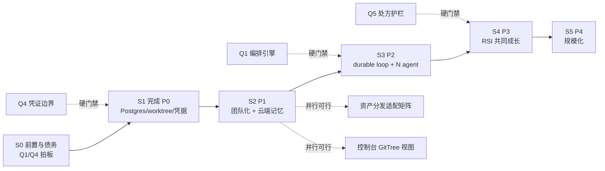

# SuperAgent 研发工具管理平台 · 完整实施计划 v1

> 状态：供评审 / 仅规划，不含实施动作
> 日期：2026-11-15
> 上游依据：`docs/superagent-architecture-discussion-v1.md`（架构设计讨论稿 v1）
> 规划容器：`.trellis/tasks/11-15-superagent-full-plan/`

---

## 0. 结论先行

这份计划把架构讨论稿的七层架构与 P0–P4 路线，转成**从当前代码基线出发、按依赖排序、每阶段可验收**的完整实施蓝图。它回答三件事：现在到底做到了哪一步、剩下按什么顺序做、哪些决策必须先拍板。

| 结论 | 内容 |
| --- | --- |
| 当前位置 | 已完成 **P0 的一个垂直切片**（真实 verifier + append-only 事件日志 + headless-json adapter 链路），不是完整 P0；依赖缺陷已修、19 份 spec 已共享、本地 2 个提交未 push、Trellis 任务全部归档 |
| 完整路线 | **S0 前置与债务 → S1 完成 P0 → S2(P1) 团队化+云端记忆 → S3(P2) 自动 loop+N agent → S4(P3) 共同成长 → S5(P4) 规模化**，六段、五个硬依赖 |
| 关键路径 | `Q1 编排引擎选型` → `S3 durable Orchestrator` → `S4 RSI` → `S5 规模化`；`Q4 凭证边界` 是 S1 的硬门禁，`Q5 处方护栏` 是 S4 的硬门禁 |
| 最容易失控的点 | 不是"让 N 个 agent 并行写代码"，而是**自动改写流程的权力**与**团队资产被污染** |
| 本轮不做 | 不实施、不 push、不发起真实模型调用、不改产品代码；计划批准后再按阶段拆 Trellis 任务 |

**三个必须提前知道的约束**：① `push` 是外部动作，需单独授权；② 真实模型 CLI 集成会产生额度消耗且需确认登录态；③ 计划不排日历时间，用**依赖关系 + 验收口径**驱动，人力/环境假设集中写在第 11 章。

---

## 1. 基线核实（2026-11-15，来自仓库而非推测）

### 1.1 已完成

| 项 | 证据 |
| --- | --- |
| 真实确定性门禁 | `src/runtime/verifier.ts` 跑 `npm run lint` 按退出码判定；`server.ts` 的 `RUNNING→VERIFYING` 分支在 `SUPERAGENT_REAL_RUNTIME=1` 时使用真实结果，失败回灌真实 tsc 日志并进入 `RETRY_WAIT` |
| append-only 事件日志 | `src/runtime/eventLog.ts` → `.superagent-events.jsonl`，`seq` 连续、可按 `traceId` 重放；旁路证据，不参与状态决策 |
| 真实 CLI adapter | `src/runtime/adapters/headlessJson.ts` 实现 `AgentRunnerAdapter`；stdout NDJSON 经 `parseCliNdjsonLine()` 脱敏与危险拦截。**真实模型 CLI 未实测**，验收用本地 NDJSON 源做链路自检 |
| 受控端点 | `POST /api/tasks/:id/real-spawn`（要求显式 `SUPERAGENT_CLI_COMMAND`）、`GET /api/runtime/events`；开关关闭时 Demo 行为不变 |
| 质量基线 | `npm test` 14/14（`node --import tsx --test`）、`npm run lint` 退出码 0；`esbuild` 升 `^0.28.0`、`bun.lock` 归位为 `package-lock.json`、安装不再需要 `--legacy-peer-deps` |
| 规范与文档 | `.trellis/spec/` 19 份基于真实代码的规范已进版本控制；架构讨论稿 v1 已提交；journal 与 memory 记录完整 |
| 版本控制 | `eda9413`（P0 垂直切片）、`b8c3d0d`（共享 Trellis 规范）；工作区 Clean；`origin/main` 仍为 `8eae911`，**未 push** |
| Trellis 状态 | CURRENT TASK none、ACTIVE TASKS 0；本计划新建的 `11-15-superagent-full-plan` 为 `planning` |

### 1.2 与架构稿 P0 的偏差（需在下阶段补齐）

| 架构稿 P0 原义 | 垂直切片实际 | 补齐阶段 |
| --- | --- | --- |
| Postgres + event log 替换单文件 JSON | 本地 NDJSON 事件日志叠加，`.superagent-state.json` 仍全量覆盖写 | S1 |
| 拆分 `server.ts` | 只在原文件内加受控分支与 2 个端点，仍为 1300+ 行单文件 | S1 |
| 建议 ACP adapter | headless-json adapter，ACP 未接 | S1 |
| `git worktree` 真建真删、凭据网关 | 未建 worktree，cwd 固定仓库根；无凭据注入 | S1（Q4 门禁） |
| 清理已提交 state 与硬编码密钥 | 未处理（Q11） | S0 |
| 真实 verifier 跑 lint/typecheck/test | 只跑 lint；其余检查**不伪造为通过** | S0 补脚本 + S1 扩展 |

### 1.3 遗留债务清单

| 编号 | 债务 | 影响 | 建议归属 |
| --- | --- | --- | --- |
| D1 | `.teamai/hooks/pre-merge-gate.sh` 与 `AGENTS.md` 要求 `pnpm lint/typecheck/test`，实际只有 `lint` + `test` 且用 npm | 门禁脚本不可直接运行 | S0 |
| D2 | `package.json` 的 `name` 仍是 `react-example` | 包标识错误 | S0 |
| D3 | `.superagent-state.json` 含内部 hostname、模拟数据、默认 IM 密钥明文 | 合规风险（Q11） | S0 |
| D4 | `tsconfig` 未开 `strict`；`saveState()` 静默吞写失败；`syncedToGit=true` 无 git 操作 | 可靠性 | S0/S1 |
| D5 | 状态机原 8 态缺 `BLOCKED_BY_RESOURCE` / `QUARANTINED` / `WAITING_APPROVAL`（Q12） | 长时等待与污染隔离无法表达 | **S0-4 已补齐（11 态，18 用例全绿）**；新状态的生产者逻辑仍待 S1/S3 接入 |
| D6 | 真实模型 CLI 登录态 / stream-json 事件结构未实测 | adapter 端到端未闭环 | S0（需授权） |
| D7 | 本地 2 个提交未 push | 远端无最新代码 | S0（需授权） |

---

## 2. 目标、非目标与约束

**目标**：把演示原型演进为架构稿定义的团队级控制面——统一注册本地 AI 工具与 CLI、团队资产与记忆云端共享、N 个 agent 按角色分工、需求到交付自动 loop 可暂停可接管。

**非目标**：不自研模型/不重训；不做 IDE；不做通用办公 agent；v1 不做跨组织联邦、不做公开市场分发；**本计划本身不实施**。

**硬约束**：本地 CLI 凭证不出内网（Q4）；日志与记忆写入前脱敏；合并、资产发布、SOP 改写、权限放开四件事必须人审；team/project/user/agent 四级 ACL；CLI 版本碎片与网络分区是常态。

---

## 3. 阶段总表

| 阶段 | 目标 | 关键交付 | 前置 | 验收（可观察） | 明确不做 |
| --- | --- | --- | --- | --- | --- |
| **S0 前置与债务** | 清掉会放大的债、拍板安全边界 | D1–D7 处理；Q1/Q4 决策；状态机补 3 态；`.superagent-state.json` 脱敏 | 计划批准 + 授权 | `npm run lint`/`npm test` 全绿；门禁脚本可运行；默认密钥不再明文；state 文件不含内部信息 | 数据库、多租户 |
| **S1 = 完成 P0** | 从"一条真流程"变成"真平台骨架" | 拆 `server.ts`；Postgres + event log；worktree 真建真删；凭据网关；ACP adapter；真实模型 CLI 集成 | S0；Q4 拍板 | 一条 `bugfix_flow` 从需求到 PR 全程真实、崩溃可恢复、可重放；换一个 CLI 也能跑通 | 多租户、云端记忆、RSI |
| **S2 = 架构稿 P1** | 资产与记忆成为组织能力 | SSO/RBAC + 四级 ACL；Git-native Asset Registry（MR + hook）；Memory Hub L0–L3 四类资产、混合召回；真实 MCP server；审核台与埋点 | S1；Q2/Q13 拍板 | 两个不同 CLI 消费同一份团队 Skill；draft 不被召回；资产可回退 | 自动改写 SOP |
| **S3 = 架构稿 P2** | 流程自己跑，人只在关键节点拍板 | durable Orchestrator；SOP Registry/DAG 编译；Agent Registry + 多 adapter；Scheduler/租约/Watchdog；三类门禁 + IM 审批 + 三挡放行；OTel trace/cost/eval | S2；**Q1 拍板** | 首次通过率/返工次数有基线；门禁误放行率 0；掉线恢复率达标 | 跨组织联邦 |
| **S4 = 架构稿 P3** | 越跑越准 | RSI 复盘与健康度评分；处方 MR + 护栏 + 灰度/回滚；SOP/角色/门禁版本化；低质资产淘汰；质量成本看板 | S3；**Q5 必须 B** | 同类问题复发率下降；召回采纳率上升；处方全部可追溯可回退 | 无人审批的自动合并 |
| **S5 = 架构稿 P4** | 多团队、多仓、云沙箱 | 多租户配额、云沙箱与快照、自有机器接入、跨仓 DAG、成本治理、内部资产市场 | S4；Q9/Q10 | 多团队并发互不影响，成本可归因 | 公开商业化分发 |

---

## 4. 依赖关系与关键路径

**关键路径**：`Q1 → S3 → S4 → S5`。Q1 若不早拍板，S3 的 Orchestrator 无法定型，会连带拖延 RSI 与规模化。**可并行的支线**：S2 内部的资产分发适配矩阵（D8/Q13）与控制台可视化，不阻塞主链；S0 的 D1/D2/D3 可与 Q1 决策并行。

**反模式提醒**：不要因为"S2 还没做完"就把 S1 拆得过细，也不要在 S1 提前引入多租户（架构稿明确列为 P0 的"不做"）。

---

## 5. 分阶段详细计划

### 5.0 S0 · 前置与债务清理

| WBS | 工作包 | 涉及文件 / 模块 | 依赖 | 验证 | 风险 |
| --- | --- | --- | --- | --- | --- |
| S0-1 | 对齐门禁脚本与工程实际（D1） | `.teamai/hooks/pre-merge-gate.sh`、`.teamai/AGENTS.md`、`package.json` | 计划批准 | 脚本可执行且全绿 | 改团队资产需评审 |
| S0-2 | 包标识与元数据（D2） | `package.json` | — | `npm run lint` | 低 |
| S0-3 | state 文件脱敏与移出版本控制（D3/Q11） | `.superagent-state.json`、`.gitignore`、`server.ts:36-37` | 备份 | 文件不含 hostname/密钥；默认 IM secret 由 env 注入 | 需清理 git 历史，动作较重 |
| S0-4 | 状态机补 3 态（D5/Q12） | `src/engine/stateMachine.ts`、`src/protocol/index.ts`、`src/utils/statusStyles.ts` | S0-3 | `npm test` 新增用例通过；`Record` 映射穷举不报错 | 前端展示映射需同步 |
| S0-5 | 真实模型 CLI 集成探测（D6） | `src/runtime/adapters/headlessJson.ts`、`research/cli-probe.md` | **用户授权** | 用 `codex exec` 或 `claude -p --output-format stream-json` 跑一次只读任务，记录真实事件行与返回码 | 额度消耗、登录态 |
| S0-6 | push 策略（D7） | git 远端 | **用户授权** | `origin/main` 与本地一致 | 外部动作 |
| S0-7 | Q1/Q4 决策落地 | 本计划第 6 章 | 平台/安全负责人 | 决策写入 design/spec | 未拍板则 S1/S3 阻塞 |

**验收**：`npm run lint` + `npm test` 全绿；D1–D5 关闭；D6/D7 状态明确（完成或书面 deferred）；Q1/Q4 形成书面结论。
**不做**：Postgres、worktree、多租户、任何 SOP 自动改写。

### 5.1 S1 · 完成 P0（把垂直切片扩成平台骨架）

| WBS | 工作包 | 涉及模块 | 依赖 | 验证 | 风险 |
| --- | --- | --- | --- | --- | --- |
| S1-1 | 拆分 `server.ts` | 新增 `src/server/` 路由层 + 现有纯函数模块 | S0 | 现有 20+ 端点响应逐字段对比不变 | 大文件重构易回归 |
| S1-2 | Postgres + append-only event log | 替换 `STATE_FILE` 全量写；沿用 `src/runtime/eventLog.ts` 格式 | S1-1、Q1 结论 | 崩溃重启后状态与事件一致；重放不二次写状态 | 数据迁移、双写一致性 |
| S1-3 | worktree 真建真删 + 快照 | **M14** Workspace Manager | S1-2、Q9（先单仓） | 两并行任务写集不冲突；休眠/唤醒无损 | 磁盘与端口占用 |
| S1-4 | 凭据网关（Q4） | **M15** Credential Broker | **Q4 拍板** | 模型侧只见占位符；任务结束密钥擦除 | 提示注入最大攻击面 |
| S1-5 | ACP adapter + 多 CLI 注册 | **M12**；`src/runtime/adapters/` | S1-4 | 同一 `TaskSpec` 可在 Codex/Claude Code 间切换 | CLI 版本碎片 |
| S1-6 | 真实 verifier 扩展 | **M8**；`src/runtime/verifier.ts` | S0-1 | lint/typecheck/test/覆盖率按退出码；未执行项不伪造 | 测试"静默腐化" |
| S1-7 | 真实模型 CLI 端到端 | S0-5 | S0-5 | 一条 `bugfix_flow` 从需求到 PR 全程真实 | 额度与登录态 |

**验收**：架构稿 P0 口径——一条 `bugfix_flow` 全程真实、可重放、崩溃可恢复；换一个 CLI 仍可跑通。
**不做**：多租户、云端记忆、RSI、跨仓（Q9 放 S5）。

### 5.2 S2 · 团队化协作 + 团队记忆云端化（架构稿 P1）

| WBS | 工作包 | 涉及模块 | 依赖 | 验证 | 风险 |
| --- | --- | --- | --- | --- | --- |
| S2-1 | SSO/OIDC + RBAC + 四级 ACL | M1 Team & Identity | S1 | 跨 team/project 越权被拒；审计留痕 | 企业身份系统对接 |
| S2-2 | Git-native Asset Registry | M17；`.teamai/`；对齐 teamai-cli、Agent Skills 规范 | S1、Q2/Q13 | `push→MR→评审→hook pull` 闭环；可回退 | 双写一致性 |
| S2-3 | Memory Hub L0–L3 + 四类资产 | M16；对齐 TencentDB-Agent-Memory | S2-2 | Chat Memory / LLM-Wiki / Code Graph / Skill 均可生成、审核、按角色装配 | 分层提炼质量 |
| S2-4 | 混合召回与上下文装配 | M18；替换 `recallEngine.ts` trigram | S2-3 | 只召回 published；命中率/采纳率埋点生效（Q6） | 记忆污染 |
| S2-5 | 真实 MCP server | 替换 `/api/mcp/recall` 假端点 | S2-4 | 外部 CLI 通过 MCP 调用 `memory_recall/propose` | 协议兼容 |
| S2-6 | 共享会话 + Main Bot + 渠道网关 | M2；参考 Octop/LoopForge | S2-1 | 产品/研发同一会话，上下文不靠复制粘贴 | 多人发言越权 |
| S2-7 | 资产适配矩阵与回归（Q13） | teamai-cli 的 scorer/benchmark 思路 | S2-2 | 同一 Skill 在 16+ 工具触发语义一致 | 工具差异 |
| S2-8 | 审核台与控制台 GitTree | M21；参考 Lancer | S2-3 | draft/published 隔离可视；运行事件图可下钻 | 前端改动面 |
| S2-9 | 策略引擎与不可变审计 | **M19**；CEL/OPA + 审计链 | S2-1 | 工具 grants 交集、危险命令、路径白名单；先写审计行再执行 | 策略散落、审计缺口 |

**验收**：两个不同 CLI 消费同一份团队 Skill；draft 不被召回；资产可回退。
**不做**：SOP 自动改写（P2 再说）。

### 5.3 S3 · 自动 loop + N 个 agent 分工（架构稿 P2）

| WBS | 工作包 | 涉及模块 | 依赖 | 验证 | 风险 |
| --- | --- | --- | --- | --- | --- |
| S3-1 | durable Orchestrator | M6；Temporal 或 Postgres 幂等状态机 | **Q1 拍板** | 人工门禁等待数小时不丢状态；崩溃续跑 | 多一套集群运维 |
| S3-2 | SOP Registry + DAG 编译 | M5；替换 `server.ts` 硬编码模板 | S3-1 | 模板版本化；子 SOP 可复用 | 流程维护成本 |
| S3-3 | Agent Registry + 工具 grants 交集 | M11；参考 CopilotKit OpenBot | S3-2、Q7 | 实际工具集 = skill 声明 ∩ agent grants ∩ 策略 | 角色漂移 |
| S3-4 | Scheduler / 租约 / Watchdog | M7、M13 | S3-3 | 掉线自动改派；卡死被诊断而非无限重试 | 并发上限 |
| S3-5 | 三类门禁 + IM 审批 + 三挡放行 | **M4**、M9、M12；Q8 | S3-1 | 门禁误放行率 0；IM 回调验签+防重放 | 代批模型注入 |
| S3-6 | OTel GenAI trace / cost / eval | M20；Langfuse 自托管 | S3-1 | 跨服务 trace 串通；成本可归因 | 内容捕获默认关闭 |
| S3-7 | 结构化 Handoff + 交叉审查异构 | M11、`HandoffContract` | S3-3 | 节点间只传交付物；reviewer 不同模型家族 | 同家族共犯错误 |
| S3-8 | 补 3 态后状态机回归 | `stateMachine.ts` | S0-4 | `npm test` 全绿 | 前端映射同步 |
| S3-9 | 需求入口与规格化 | **M3**；Spec Kit 风格 `constitution → specify → plan → tasks` | S3-1 | 需求产出活文档工件；澄清回路可打回 | 需求含糊直接进 DAG |

**验收**：首个通过率与返工次数有基线；门禁误放行率 0；掉线恢复率达标。
**不做**：跨组织联邦。

### 5.4 S4 · 共同成长（架构稿 P3）

| WBS | 工作包 | 涉及模块 | 依赖 | 验证 | 风险 |
| --- | --- | --- | --- | --- | --- |
| S4-1 | 轨迹回放与健康度评分 | M10 | S3-6 | 0–100 分可复算，卡点定位准确 | 评分主观 |
| S4-2 | 结构化处方生成 | M10 | S4-1 | 处方含证据链与影响面 | 幻觉 |
| S4-3 | 处方 MR + 护栏（**Q5 必须 B**） | M17 | S4-2、Q5 | 禁止删门禁/放宽预算/自签名；一键回滚 | **自动改写失控** |
| S4-4 | SOP / 角色 / 门禁版本化 | M5、M11 | S4-3 | 每次改写生成新版本，可灰度 | 版本爆炸 |
| S4-5 | 低质资产复评淘汰 + 负反馈 | M16/M18 | S2-4 | 命中率/采纳率上升，低分资产归档 | 记忆污染（Q6） |
| S4-6 | 质量与成本看板 | M21 | S3-6、S4-5 | 一级指标可见 | 指标堆砌 |

**验收**：同类问题复发率下降；召回采纳率上升；处方全部可追溯可回退。
**不做**：无人审批的自动合并。

### 5.5 S5 · 规模化（架构稿 P4）

| WBS | 工作包 | 依赖 | 验证 |
| --- | --- | --- | --- |
| S5-1 | 多租户配额与成本归因 | S4 | 多团队并发互不影响 |
| S5-2 | 云端沙箱 + 快照休眠/唤醒 | S1-3 | 合盖断流后任务续跑 |
| S5-3 | 自有机器一键接入、存算分离 | S5-2 | 云主机/开发机可接单 |
| S5-4 | 跨仓 DAG 与写集冲突编排（Q9） | S3-4 | 多仓联调不互相覆盖 |
| S5-5 | 内部资产市场、许可证清单（Q10） | S2-2 | 受限许可代码不混入 |

**验收**：多团队并发互不影响，成本可归因。**不做**公开商业化分发。

### 5.6 模块覆盖矩阵（M1–M21 → 阶段 / WBS）

架构讨论稿第 5 章定义 21 个模块。下表是本计划对它们的**完整归位**，用于检查是否有模块被漏排。`当前状态` 只描述本仓库，不代表目标能力已具备。

| 模块 | 架构稿职责 | 归属阶段 | 对应 WBS | 当前状态 |
| --- | --- | --- | --- | --- |
| M1 | Team & Identity | S2 | S2-1 | 未开始 |
| M2 | Shared Session & Channel Gateway | S2 | S2-6 | 仅 `imWebhook.ts` 验签/卡片 |
| M3 | Requirement Intake & Spec Compiler | S3 | **S3-9（新增补齐）** | 未开始；`/api/requirements` 只收标题+specMd |
| M4 | Approval & Human Gate | S3 | S3-5 | 原型已有 `TaskCheckpoint` 与三类门禁语义 |
| M5 | SOP / DAG Registry | S3 / S4 | S3-2、S4-4 | `feature_flow`/`bugfix_flow` 硬编码在 `server.ts` |
| M6 | Orchestrator（durable） | S3 | S3-1 | 未开始；现为内存状态机 + 手工推进 |
| M7 | Scheduler & Queue | S3 | S3-4 | 仅 `getReadyDagNodes()` 依赖解锁 |
| M8 | Verifier | S1 | S1-6 | **P0 垂直切片已落地最小实现**（`src/runtime/verifier.ts`） |
| M9 | Gate Engine | S3 | S3-5 | `transitionTaskVerification()` 等纯函数已有 |
| M10 | Evolution / RSI Engine | S4 | S4-1/2/3 | 仅 `extractSkillDraft()` 草案提炼 |
| M11 | Agent Registry | S3 / S4 | S3-3、S3-7、S4-4 | `TaskRole` 三值枚举，无注册表 |
| M12 | Runtime Adapter Hub | S1 / S3 | S1-5、S3-5 | **P0 垂直切片已落地 headless-json adapter** |
| M13 | Daemon Fleet | S3 | S3-4 | `DaemonRunner` 类型 + 前端模拟舰队 |
| M14 | Workspace Manager | S1 / S5 | S1-3、S5-2 | `worktreePath` 只是字符串，未真建 |
| M15 | Credential Broker | S1 | S1-4 | 未开始；默认 IM 密钥硬编码 |
| M16 | Memory Hub | S2 / S4 | S2-3、S4-5 | 状态文件里的 `MemoryAsset` + trigram 召回 |
| M17 | Asset Registry（Git-native） | S2 / S4 | S2-2、S4-3 | `.teamai/` 本地文件，`syncedToGit` 假状态 |
| M18 | Recall & Context Assembly | S2 / S4 | S2-4、S4-5 | `recallEngine.ts` 四级 ACL + trigram |
| M19 | Policy & Audit | S2 | **S2-9（新增补齐）** | 仅 `detectDangerousCommand()` / `redactSecrets()` 散落规则 |
| M20 | Observability & Eval | S3 | S3-6 | 内存事件数组 + SSE，无 trace/cost |
| M21 | Console | S2 / S4 | S2-8、S4-6 | React + xyflow 四 tab，已有 DAG 画布与审核台 |

**结论**：21 个模块全部有归属阶段与 WBS 落点。其中 M8、M12 已有 P0 垂直切片的最小实现；M4、M9 有可复用的纯函数基础；其余为待建。补齐动作：**新增 S2-9（M19）、S3-9（M3）两个工作包**，并给 M4/M8/M14/M15 补上模块编号，避免"职责写了但模块追踪断链"。

---

## 6. 决策登记：Q1–Q13 → 阶段门禁

架构讨论稿第 12 章的 13 个开放问题，按"必须在哪个阶段前拍板"重新归位。倾向沿用架构稿结论，本计划不替用户做选择。

| 编号 | 决策 | 架构稿倾向 | 硬门禁阶段 | 拍板人 | 未拍板的影响 |
| --- | --- | --- | --- | --- | --- |
| Q1 | Temporal vs 自研幂等状态机 | 倾向 Temporal | **S3-1**（S1-2 需先定抽象） | 平台负责人 | S3 无法定型，连带拖 S4/S5 |
| Q2 | Git 与 Memory Hub 双写一致性 | Git 权威，Hub 可重建索引 | S2-2 | 平台负责人 | 资产发布事务边界不清 |
| Q3 | 与 LoopForge/teamai-cli 关系 | 借语义自研、复用协议 | S2-2 | 平台负责人 | 生态孤岛或重复造轮子 |
| Q4 | 本地 CLI 凭证 vs 云控制面 | 凭证留本机 + 短期注入 | **S1-4** | 安全负责人 | 提示注入攻击面敞开 |
| Q5 | SOP 自动改写护栏 | **必须"处方 MR + 人审 + 护栏"** | **S4-3** | 平台负责人 | 自动流程失控 |
| Q6 | 记忆防污染度量 | 命中率/采纳率/复发率为一级指标 | S2-4 | 平台负责人 | 记忆越写越脏 |
| Q7 | N agent 角色粒度 | 固定角色起步、评审注册 | S3-3 | 平台负责人 | 角色漂移 |
| Q8 | 人工门禁注意力成本 | 三挡放行、v1 默认每次确认 | S3-5 | 产品负责人 | 审批疲劳或越权 |
| Q9 | 多仓/worktree 冲突 | P0 单仓，跨仓放 P4 | S1-3 / S5-4 | 平台负责人 | 过早承诺多仓并行 |
| Q10 | 许可证合规 | 受限代码只借鉴不复制 | S2-2 / S5-5 | 法务/平台 | 商用授权风险 |
| Q11 | 已提交 state 文件清理 | S0 第一件事 | **S0-3** | 安全负责人 | 内部信息泄露 |
| Q12 | 状态机补 3 态 | 补，保持纯函数可测 | S0-4 | 平台负责人 | 长时等待/污染隔离无法表达 |
| Q13 | 跨工具资产一致性 | 适配矩阵 + 分发前校验 | S2-7 | 平台负责人 | 同一 Skill 各工具行为不一 |

**建议的拍板顺序**：Q4 → Q11 → Q1（S0 内一次会议解决），Q2/Q3/Q13（S2 启动前），Q5/Q6（S3 启动前），其余随阶段。

---

## 7. 数据与契约演进

| 演进 | 现状 | 目标 | 兼容策略 |
| --- | --- | --- | --- |
| 控制面状态 | `.superagent-state.json` 全量覆盖写 | Postgres 表 + append-only event log | 事件日志格式沿用 `src/runtime/eventLog.ts`；提供一次性迁移脚本与回退快照 |
| 事件契约 | `DaemonEnvelope`（seq/ack） | v2 补 `trace_id` / `idempotency_key` / `lease` | 字段只增不改；旧消费者忽略未知字段 |
| 共享类型 | `src/protocol/index.ts` 单一契约 | 增加 `HandoffContract`、`AgentDefinition`、`SopDefinition` | 只放 protocol；展示副本 `PROTOCOL_SPEC` 需同步核对 |
| 团队资产 | 本地 `.teamai/*.md`、`syncedToGit` 假状态 | Git 仓为权威，`asset_id + version + commit_sha` 锚定 | 现有 `.teamai/` 作为初始导入源 |
| 记忆资产 | `MemoryAsset` 在 state 文件里、trigram 召回 | Memory Hub 分层 + 混合召回 | `published` 才可召回的反污染规则保留 |
| 配置 | `IM_WEBHOOK_SECRET` 默认明文 | 环境注入 + 密钥库 | S0-3 轮换 |

**回滚原则**：每个阶段保留上一阶段的可运行快照；数据库变更必须可回退；SOP/资产改写一律走版本 + MR，不直接覆盖。

---

## 8. 工程实践与质量门禁

每个阶段（含 S0）都必须满足：

| 门禁 | 要求 |
| --- | --- |
| 自动检查 | `npm run lint`（`tsc --noEmit`）+ `npm test`（现有 14 用例起，随阶段增长）；**不得**照抄 `.teamai` 的 `pnpm` 三命令 |
| 客观门禁 | 编译/测试/覆盖率按退出码判定，未执行的检查项不得伪造为通过 |
| 规范同步 | 新约定写入 `.trellis/spec/`，index 与文件集 1:1、无 placeholder、链接可达 |
| 证据链 | 每个自动结论可下钻到原始日志/退出码/commit |
| 提交 | 每阶段一个本地提交；`push` 需单独授权；不跑 `task.py archive` 的自动提交（用 `--no-commit`） |
| Trellis | 每阶段建父任务 + 按 WBS 拆子任务；planning → start → 实施 → check → finish/archive |
| 红线 | 门禁误放行率必须为 0；合并/资产发布/SOP 改写/权限放开四件事人审 |

---

## 9. 里程碑与度量

指标沿用架构讨论稿第 13 章，并把它们绑定到阶段：

| 指标 | 基线 | S1 | S2 | S3 | S4 | S5 |
| --- | --- | --- | --- | --- | --- | --- |
| 门禁误放行率 | 演示态（无真实门禁） | **0** | 0 | 0 | 0 | 0 |
| 首次通过率 | 未采集 | 建基线 | — | 提升 | 明显提升 | 稳定 |
| 平均返工次数 | 未采集 | 建基线 | — | 下降 | 下降 | 稳定 |
| 召回命中率 / 采纳率 | 无记忆服务 | — | 建基线 | 上升 | 上升 | 稳定 |
| 同类问题复发率 | 无 | — | — | 建基线 | 下降 | 稳定 |
| 任务恢复率 | 无 | ≥99% | ≥99% | ≥99% | ≥99% | ≥99% |
| 人均并行活跃需求数 | 1 | 2 | 3 | 5 | 5 | 多团队 |
| token/需求成本 | 未采集 | 可归因 | 可归因 | 有告警 | 优化 | 配额治理 |

**看板原则**：记忆条数不算指标；所有指标必须能下钻到具体 run/trace。

---

## 10. 风险登记

| 风险 | 阶段 | 影响 | 缓解 | 触发条件 |
| --- | --- | --- | --- | --- |
| 自动改写 SOP 失控 | S4 | 高 | Q5 必须 B：处方只提 MR + 护栏 + 灰度 + 回滚 | 出现"处方自动生效"的实现 |
| 云控制面触达本地凭证 | S1 | 高 | Q4 硬门禁；短期注入、结束擦除、出网白名单 | adapter 能读到明文 key |
| 记忆污染 | S2/S4 | 中高 | 只召回 published、draft 隔离、去重阈值、TTL、负反馈淘汰 | 命中率上升但采纳率下降 |
| 测试"静默腐化" | S1/S3 | 中 | 增量覆盖率、门禁脚本版本化、定期 eval | 门禁全绿但新逻辑没测到 |
| 大文件 `server.ts` 重构回归 | S1 | 中 | 拆分前后逐字段对比 20+ 端点响应 | 任一端点形状变化 |
| 依赖/锁文件漂移 | 全程 | 中 | 已修：npm lockfileVersion 3、`!package-lock.json`；新增依赖先跑 lint/test | 安装需 `--legacy-peer-deps` 复现 |
| CLI 登录态与额度 | S0/S1 | 中 | 探测先行、失败标 deferred、不伪造结果 | 真实 CLI 调用失败 |
| 多仓写集冲突 | S5 | 中 | 写集声明 + 合并顺序 + 冲突回灌 | 两任务改同一文件 |
| 许可证污染 | S2/S5 | 中 | 引入前清单核对；受限代码只借鉴 | 引入 PolyForm/单独许可组件 |
| 人工审批疲劳 | S3 | 中 | 三挡放行 + 独立审查模型代批（无工具无凭证） | 单人日均审批次数过高 |

---

## 11. 资源与假设

- **不排日历时间**：用依赖顺序与验收口径驱动；阶段工期在各自 Trellis 任务里按实际人力估算。
- **人力假设**：至少 1 名平台/后端、1 名前端（S2 控制台）、1 名安全负责人（Q4/Q11 拍板）、1 名平台负责人（Q1/Q5 拍板）。
- **环境假设**：可自托管 Postgres；可用 OIDC/SSO；可用企业 IM（飞书/企微）做审批卡；本机/云主机可跑 Codex / Claude Code CLI 且已登录。
- **外部依赖**：ACP Registry、MCP、Agent Skills 规范、teamai-cli、TencentDB-Agent-Memory、OTel GenAI / Langfuse；引入前做许可证核对（Q10）。
- **未验证假设**：真实模型 CLI 的登录态、stream-json 事件结构、返回码（S0-5 探测）；Temporal 集群运维成本（Q1 决策依据）。

---

## 12. 与 Trellis 的协作方式

- 本计划容器：`.trellis/tasks/11-15-superagent-full-plan/`（`planning`，不 `start`）。
- 每个阶段批准后建**父任务**，WBS 工作包按需拆子任务；复杂任务须有 `prd.md` / `design.md` / `implement.md` 与真实 manifest 条目。
- 实施前加载 `trellis-before-dev` 读对应 spec；结束走 `trellis-check` → 规范更新 → journal → `finish/archive --no-commit`。
- 计划变更走 PRD 更新并重新呈现最终摘要，不静默改范围。
- 已完成并归档的 `11-15-superagent-delivery-plan`（P0 垂直切片）与 `00-bootstrap-guidelines` 在 `.trellis/tasks/archive/2026-11/`，可作范例。

---

## 13. 下一步与需批准事项

**本计划不实施**。进入 S0 前需要：

| 类型 | 事项 | 说明 |
| --- | --- | --- |
| 计划批准 | 确认本计划的范围、阶段顺序、验收口径 | 用户下一句明确批准 |
| 决策拍板 | **Q4（凭证边界）、Q11（state 清理）、Q1（编排引擎）** | 建议在 S0 内一次会议解决，否则 S1/S3 阻塞 |
| 动作授权 | `git push`（外部动作）、S0-5 真实模型 CLI 探测（额度消耗） | 需单独一句话 |
| 可选 | 是否把本计划与架构稿一起 push 到远端 | 同上 |

---

## 附录 A：参考文档

| 文档 | 路径 |
| --- | --- |
| 架构设计讨论稿 v1 | `docs/superagent-architecture-discussion-v1.md` |
| 真实运行时规范 | `.trellis/spec/backend/real-runtime.md` |
| 共享契约 / 团队资产 | `.trellis/spec/guides/shared-contracts.md`、`team-assets.md` |
| CLI 探测记录 | `.trellis/tasks/archive/2026-11/11-15-superagent-delivery-plan/research/cli-probe.md` |
| 前后端规范索引 | `.trellis/spec/backend/index.md`、`frontend/index.md` |
| 参考项目清单 | 架构讨论稿附录 A |

## 附录 B：术语

**S0–S5**：本计划的阶段编号；**P0–P4**：架构稿的演进阶段编号（S1=P0 剩余，S2=P1，依次对应）。**durable Orchestrator**：状态持久化、崩溃可续跑的工作流引擎。**RSI**：工程级递归自改进，用运行轨迹反哺 SOP/角色/门禁，不涉及模型权重。**Handoff**：节点间结构化交付物。**Q1–Q13**：架构稿第 12 章的开放问题，本计划第 6 章重新归位。
